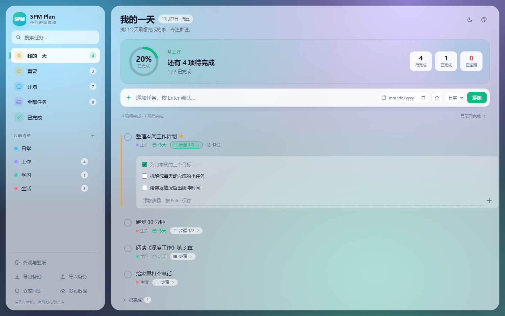

# SPM Plan · 任务进度管理

一个类似 Microsoft To Do 的轻量任务管理页面：玻璃拟态 UI、任务进度环、步骤拆解、自定义壁纸，纯 HTML / CSS / JavaScript，无依赖、无需构建，直接放到 GitHub Pages 就能用。



## 功能

- **智能清单**：我的一天、重要、计划、全部任务、已完成
- **自定义清单**：新建 / 删除，不同颜色区分
- **任务**：标题、所属清单、到期日期、重要标记、我的一天、备注
- **步骤拆解**：任务行点“步骤”按钮即可在主界面展开，勾选、添加、删除子步骤，不用进入详情页
- **进度环**：当前视图完成率、待完成 / 已完成 / 已逾期统计
- **搜索**：标题、备注、步骤全文搜索（快捷键 `/`）
- **撤销删除**：误删任务或清单，可在 Toast 里一键恢复
- **壁纸**：6 套内置渐变壁纸、上传本地图片、图片 URL，支持模糊与遮罩调节
- **界面通透度**：面板不透明度、玻璃模糊可调；低透明度时自动保留文字对比底板，壁纸更清晰、文字始终清楚
- **主题**：浅色 / 深色 / 跟随系统，5 种主题色
- **数据**：本地 `localStorage` + 仓库 `tasks.json` 自动读取；支持发布、备份、导入
- **响应式**：桌面双栏，移动端抽屉式侧栏

## 文件说明

```
SPM plan/
├── index.html   页面结构
├── style.css    全部样式（玻璃拟态、主题、响应式）
├── app.js       全部交互逻辑与数据管理
├── tasks.json   仓库数据快照（页面打开时自动读取；发布时替换它）
├── SPM Plan Desktop/  Windows 桌面版（exe、依赖、源码、zip）
├── preview.png  界面预览
├── LICENSE      MIT
└── README.md
```

网页相关文件必须放在同一目录，`index.html` 通过相对路径引用 `style.css`、`app.js`，并在 GitHub Pages 下自动读取 `tasks.json`。

## 快速开始

### 本地打开

直接双击 `index.html` 即可使用。数据保存在当前浏览器里，不需要服务器。

注意：`file://` 模式下浏览器会禁止页面读取 `tasks.json`，所以「仓库同步」不可用；需要该功能时请用 GitHub Pages，或在本地运行 `python -m http.server` 后访问 `http://localhost:8000/`。

### Windows 桌面版

`SPM Plan Desktop/` 里是打包好的在线桌面版：

- `SPM Plan.exe`：双击启动，使用系统 WebView2 打开你的 GitHub Pages；任务仍从仓库 `tasks.json` 读取。
- `SPM-Plan-Windows-x64.zip`：可单独分发的压缩包；解压后双击 exe。
- `src/`：C# 源码，方便以后重新编译。
- `config.ini`：修改里面的 `url=` 可以更换打开的 Pages 地址。

桌面版需要联网和 Microsoft Edge WebView2 运行库；请保持 exe 与同目录 DLL 文件在一起。详细说明见 `SPM Plan Desktop/README.txt`。

### 发布到 GitHub Pages

1. 把本文件夹里的文件提交到仓库根目录（或任意子目录）。
2. 打开仓库 **Settings → Pages**。
3. **Source** 选择 `Deploy from a branch`，分支选 `main`，目录选 `/ (root)`，保存。
4. 等待 1 分钟左右，访问 `https://<你的用户名>.github.io/<仓库名>/`。

若放在子目录，例如 `docs/`，则 Pages 目录选择 `/docs`，访问路径相应加上 `/docs/`。

## 仓库同步与发布

`tasks.json` 既是示例数据，也是仓库里的「数据快照」。通过 GitHub Pages 打开时，页面会自动读取它。

### 换电脑 / 第一次打开

新浏览器没有本地数据时，页面会直接载入仓库里的 `tasks.json`。因此换机后只要打开同一个 Pages 地址，任务、清单、备注、步骤都会自动出现。

如果仓库里还是示例 `tasks.json`，载入的就是示例数据；请先按下面的「更新任务」发布一次自己的数据。

### 首次从本机迁移

如果任务目前只存在旧电脑的浏览器里：

1. 在旧电脑打开你实际使用过的入口（本地 `index.html` 或旧的 Pages 地址）。
2. 点击左下角 **发布数据**，下载 `tasks.json`。
3. 在 GitHub 仓库里上传并替换同名的 `tasks.json`，提交。
4. 新电脑打开 Pages 地址，会自动载入。

如果旧电脑上用的是本地 `file://` 方式，发布按钮依然可用（它只负责生成文件，不需要读取仓库）。

> **注意**：任务并不在 `index.html` 里。只替换 HTML 文件不会同步任务，必须发布/替换 `tasks.json`。

### 更新任务

1. 在页面里正常编辑任务。
2. 点击左下角 **发布数据**，下载 `tasks.json`。
3. 到 GitHub 仓库里上传并替换同名的 `tasks.json`，提交。
4. 等其他设备刷新页面。如果仓库版本比它本地的新，会出现「仓库有较新的任务数据」提示，点 **载入** 即可。

补充：

- 只改任务时**不需要重新上传 HTML / CSS / JS**，只替换 `tasks.json` 就够了；只有改代码时才需要上传其他文件。
- **导出备份** 会下载带日期的完整 JSON（`spm-plan-日期.json`），用于额外留档，不会影响仓库。
- **仓库同步** 是手动强制读取仓库版本；载入后 4.5 秒内可以点 Toast 上的「撤销」恢复同步前的数据。
- 已有本地数据时，页面不会静默覆盖：只有仓库时间戳更新时才显示提示，由你决定是否载入。
- GitHub 提交后 Pages 通常需要几十秒到 1 分钟才生效；如果还是旧数据，稍等或强制刷新。
- 数据读取带了防缓存参数，一般不会读到旧的 `tasks.json`。

> **隐私提醒**：如果仓库和 GitHub Pages 是公开的，`tasks.json` 里的任务、备注以及你上传的壁纸图片也会公开可访问。不要把敏感内容发布到公开仓库；需要隐私时请使用私有仓库/私有 Pages，或只在本地使用。使用“上传图片”作为壁纸时，图片会以 data URL 写进 `tasks.json`，文件也会相应变大。

### 同步机制

- 每条数据带 `updatedAt` 时间戳；本地修改任务/清单时会自动更新。
- 新浏览器：直接载入仓库数据。
- 已有本地数据：仓库更新更晚 → 显示「载入」提示；本地更新更晚 → 保留本地，避免误覆盖未发布的修改。
- 多设备同时修改同一任务无法自动合并；建议以一台设备为主，发布后再在其他设备上点「载入」。

## 使用说明

### 添加任务

在中间输入框输入内容，按 `Enter` 或点「添加」。可以同时选择：

- **日期**：到期时间，逾期会标红
- **星标**：标记重要
- **清单**：任务归属

在「我的一天」视图添加会自动加入我的一天；在「重要」视图添加会自动标为重要；在「计划」视图添加且没选日期时默认今天。

### 任务操作

- 点击左侧圆圈：完成 / 取消完成
- 点击任务文字：打开右侧详情面板（修改标题、日期、清单、备注）
- 点击任务行里的 **步骤** 按钮：在当前任务下方展开步骤，可直接勾选、添加、删除
- 悬停任务：右侧出现太阳（加入我的一天）、星标（重要）、删除
- 底部「已完成」区域可展开 / 收起

### 键盘快捷键

| 快捷键 | 作用 |
| --- | --- |
| `Enter` | 在输入框中添加任务 |
| `/` | 聚焦搜索框 |
| `N` | 聚焦新任务输入框 |
| `Esc` | 关闭详情面板 / 外观设置 / 移动端侧栏 |

## 自定义壁纸

点击左下角或右上角的 **外观与壁纸**：

- **内置壁纸**：极光、晨曦、薄荷、樱花、深夜、流沙
- **上传图片**：自动压缩到 1600px 长边并转为 JPEG，避免占满浏览器存储
- **图片链接**：填入 `https://` 开头的图片地址
- **模糊 / 遮罩**：调整壁纸氛围，同时保证文字可读
- **主题色**：翡翠、紫罗兰、海蓝、玫瑰、琥珀

### 界面通透度

「外观与壁纸」里的 **界面通透度** 专门解决“面板挡住壁纸”的问题：

- **面板不透明度**：20%–90%。调低后主界面、侧栏和任务区会变得更通透，壁纸更明显。
- **玻璃模糊**：0–24px。调到 0 时透过玻璃看到的是清晰壁纸；调高则更柔和。
- **文字保护**：文字本身不参与透明度。当不透明度低于 50% 时，会自动进入通透模式：
  - 任务行、分组标题、侧栏条目保留一层半透明对比底板；
  - 文字使用与主题匹配的阴影，并按明暗主题对玻璃背后做轻度亮度校正；
  - 文字颜色保持实色，因此在亮色或暗色壁纸上都能看清。

如果想“壁纸最大化”，推荐：不透明度 `25%`、玻璃模糊 `0–4px`；想保留磨砂质感则用 `40%` + `10px` 左右。

## 数据与备份

- 数据默认存在浏览器 `localStorage`（键名 `spm-plan-data-v1`），同时会从仓库的 `tasks.json` 读取已发布快照，**不会上传到第三方服务器**。
- 换浏览器、清理缓存或换设备前，可以用侧栏 **发布数据** 更新仓库，或 **导出备份** 留一份带日期的 JSON。
- **导入** 会把 JSON 中不重复的任务合并到现有数据，不会覆盖；外观设置也不会被导入覆盖。
- `tasks.json` 是页面自动读取的仓库数据快照；要更新仓库请用 **发布数据**。**导出备份** 用于本地留档或恢复，不会修改仓库。
- 如果改坏了数据文件，页面会回退到本地数据/示例数据；重要任务建议同时留一份日期备份。

### JSON 结构

```json
{
  "app": "SPM Plan",
  "version": 1,
  "updatedAt": 1732400000000,
  "lists": [
    { "id": "work", "name": "工作", "color": "#a78bfa" }
  ],
  "tasks": [
    {
      "id": "task-1",
      "title": "写周报",
      "listId": "work",
      "done": false,
      "important": true,
      "myDay": false,
      "due": "2026-11-30",
      "note": "备注文本",
      "steps": [
        { "id": "step-1", "text": "整理数据", "done": true }
      ],
      "createdAt": 1732400000000,
      "completedAt": null
    }
  ],
  "settings": {
    "theme": "auto",
    "accent": "emerald",
    "surface": 62,
    "glassBlur": 14,
    "showCompleted": false,
    "wallpaper": { "preset": "aurora", "image": "", "blur": 0, "dim": 22 }
  }
}
```

- `updatedAt`：毫秒时间戳，用于判断仓库数据是否比本地新；「发布数据」会自动写入当前时间。
- `due` 使用 `YYYY-MM-DD`，留空表示没有日期。
- `theme`：`light` / `dark` / `auto`
- `accent`：`emerald` / `violet` / `azure` / `rose` / `amber`
- `surface`：面板不透明度，`20`–`90`
- `glassBlur`：玻璃模糊，`0`–`24`（px）
- `wallpaper.preset`：`aurora` / `sunrise` / `mint` / `sakura` / `midnight` / `dune`
- `image` 可以是图片 URL 或 data URL，优先级高于 `preset`。

## 二次开发

- **新增壁纸**：在 `app.js` 顶部的 `PRESETS` 里加一项，`css` 写任意 `background-image` 值。
- **新增主题色**：在 `ACCENTS` 里加一项（`color`、`soft`、`grad`）。
- **调整示例任务**：修改 `seedState()`；仅在浏览器没有本地数据且仓库数据也读取失败时生效。
- **修改仓库数据文件名**：修改 `app.js` 顶部的 `DATA_FILE`，并同步替换仓库里的文件。
- **清空本地数据**：浏览器开发者工具中执行 `localStorage.removeItem('spm-plan-data-v1')` 后刷新。
- **修改存储键名**：同步修改 `app.js` 的 `STORAGE_KEY` 和 `index.html` 头部预置主题脚本中的键名。

## 浏览器支持

Chrome / Edge / Firefox / Safari 近两年版本均可。使用了 `backdrop-filter`（玻璃模糊）、`fetch`、`AbortController`、`inert`、CSS 变量等现代特性；不支持 `fetch` 的旧浏览器仍能本地使用，只是不能自动读取仓库数据。

## License

MIT，随意修改与分发。
